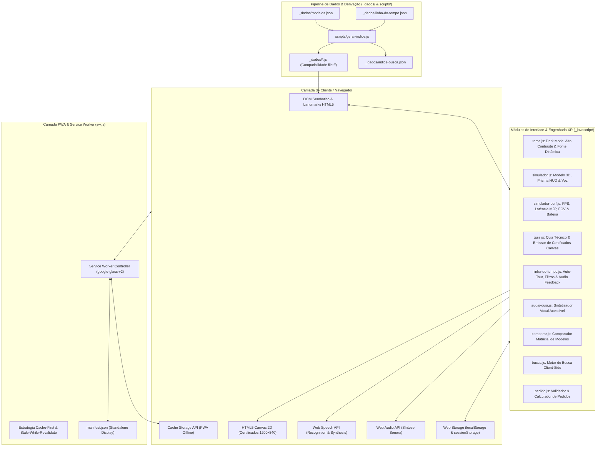
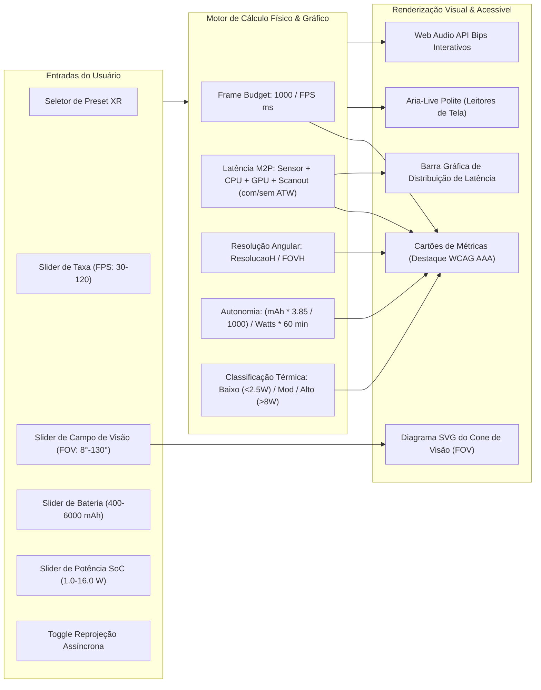
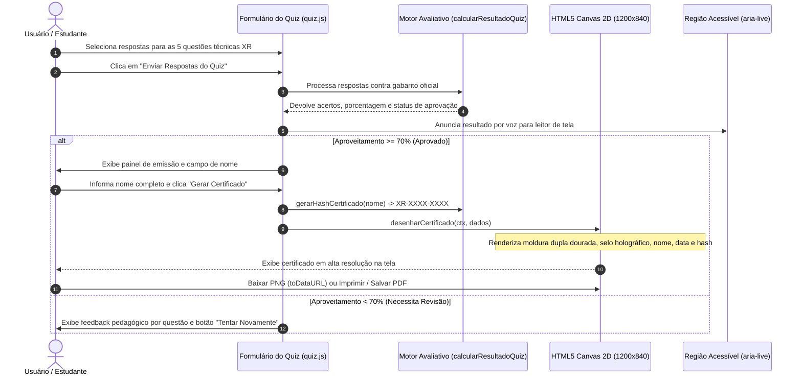
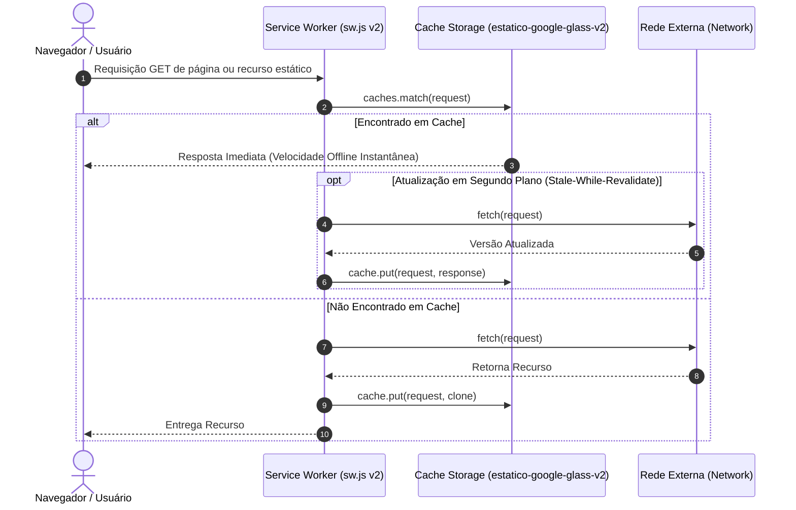

# Arquitetura do Sistema — Tudo sobre Google Glass & XR Web Portal

Este documento detalha a arquitetura de software, fluxo de dados, ciclo de vida do Service Worker PWA, pipeline computacional do Simulador de Performance AR/VR, máquina de estados do Quiz Técnico com Certificado em Canvas e a infraestrutura de acessibilidade WCAG AAA do portal **Tudo sobre Google Glass** (plataforma bilíngue PT/EN).

---

## 1. Topologia Geral e Arquitetura em Camadas

O projeto adota uma arquitetura estática pura de alto desempenho (**Zero-Dependency Vanilla Web**), compatível com execução local (`file://`) e servidores estáticos (GitHub Pages), com suporte completo a **Progressive Web App (PWA)**, Service Worker resiliente e espelhamento estrito entre português e inglês (9 páginas em PT na raiz e 9 em `en/`).

---

## 2. Pipeline de Simulação de Performance AR/VR

O módulo `_javascript/simulador-perf.js` modela fisicamente o comportamento de headsets e óculos inteligentes de Realidade Estendida em tempo real:

---

## 3. Fluxo de Avaliação do Quiz Técnico e Geração do Certificado

---

## 4. Ciclo de Vida do Service Worker e Estratégia de Cache PWA

---

## 5. Matriz de Acessibilidade WCAG 2.1 / 2.2 AAA

| Critério WCAG | Requisito AAA | Implementação no Projeto |
| :--- | :--- | :--- |
| **1.4.6 Contraste Aprimorado** | Mínimo 7:1 para texto normal, 4.5:1 para texto grande | Paleta de alto contraste verificada com razão ≥ 7:1 em todas as combinações de texto e fundo. |
| **1.4.8 Apresentação Visual** | Controle de tamanho de texto e espaçamento | Botão `#alternar-fonte` (A+ / A-) com escala rem fluida sem quebrar layout. |
| **2.1.1 & 2.1.2 Teclado** | Operabilidade 100% via teclado sem armadilhas | Linha do tempo com suporte a `ArrowLeft`, `ArrowRight`, `Home`, `End`, `Tab`; sliders acessíveis. |
| **2.2.2 Pausar, Parar, Ocultar** | Animações e tours pausáveis | Botão Auto-Tour na linha do tempo com controle explícito de Pausa e Retomada. |
| **4.1.2 Nome, Função, Valor** | ARIA semântico e sincronizado | `role="tab"`, `role="tablist"`, `role="tabpanel"`, `role="progressbar"`, `aria-live="polite"`. |
| **1.4.12 Espaçamento de Texto** | Suporte a zoom e redimensionamento | Layout flexível em `rem`, grid CSS e SVG vetorial escalável em todas as resoluções. |
