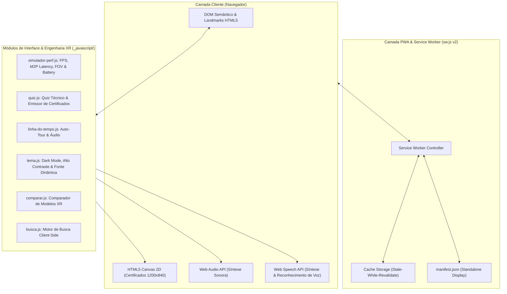

# Desenvolvimento pra internet: site "Tudo sobre Google Glass & XR Web Portal"

<p align="center">
  
</p>

<p align="center">
  <a href="#páginas"></a>
  <a href="CHANGELOG.md"></a>
  <a href="#como-testar"></a>
  <a href="#pwa--offline-ready"></a>
  <a href="#acessibilidade-wcag-aaa"></a>
  <a href="#especificações-técnicas"></a>
  
  
</p>

Site estático originalmente inspirado no exercício do curso de **HTML5 e CSS3 do Curso em Vídeo**, de Gustavo Guanabara, elevado a um patamar profissional de **Showcase Tecnológico e Laboratório de Computação Espacial / XR**.

Esta versão mantém a identidade visual clássica minimalista do Google Glass, enriquecida com engenharia web de ponta: **Simulador de Performance AR/VR em tempo real**, **Quiz Técnico com Emissor de Certificados em Canvas (1200x840 px)**, **Linha do Tempo com Auto-Tour e Síntese de Áudio Web Audio API**, **PWA Offline com Service Worker v2**, **Acessibilidade WCAG 2.1/2.2 AAA** (contraste 7:1 e escala de fontes fluida), **i18n completo (PT e EN)** e **suíte de 81 testes automatizados**.

> [!NOTE]
> Este projeto é uma iniciativa educacional e laboratório técnico livre; não é um site comercial oficial do Google LLC.

---

## 🏛️ Arquitetura do Sistema



---

## 🚀 Principais Módulos e Inovações

<a id="especificações-técnicas"></a>
### 1. Simulador de Performance AR/VR (`specs.html` e `en/specs.html`)
- **Presets XR Reais**: Google Glass Explorer (2013), Glass Enterprise Edition 2 (2019), Meta Quest 3 (2023), Apple Vision Pro (2024), Microsoft HoloLens 2 (2019) e Modo Personalizado.
- **Métricas Físicas em Tempo Real**:
  - **Taxa de Atualização & Frame Budget**: De 30 a 120 FPS com cálculo do tempo disponível por quadro (ex.: 120 FPS = 8.33 ms).
  - **Latência Motion-to-Photon (M2P)**: Modelagem detalhada do pipeline (Sensor + CPU + GPU + Scanout de tela) com toggle de **Reprojeção Assíncrona (ATW / Timewarp)** reduzindo a latência perceptual para ≤ 15 ms.
  - **Campo de Visão (FOV) & PPD**: Diagrama visual interativo em SVG do cone de visão ocular e cálculo dos Pixels Por Grau (PPD) com classificação de acuidade angular (Retiniana, Alta Fidelidade, VR Padrão e HUD Óptico).
  - **Autonomia de Bateria & Modelagem Térmica**: Estimativa de tempo de operação em horas/minutos a partir da capacidade em mAh e consumo em Watts do SoC, com detecção de risco de Thermal Throttling.
  - **Sintetizador de Áudio**: Bips acústicos em tempo real com Web Audio API ao ajustar parâmetros.

### 2. Linha do Tempo Interativa XR (`linha-do-tempo.html` e `en/timeline.html`)
- **Modo Auto-Tour**: Apresentação automatizada navegando passo a passo pela história do Glass a cada 3.8 segundos, com botão de Pausa e Retomada acessível.
- **Barra de Progresso Visual**: Componente dinâmico com atributo acessível `role="progressbar"` exibindo a porcentagem e etapa cronológica.
- **Filtros Históricos**: Filtros rápidos por fase (*Fase Explorer 2012–2015*, *Fase Enterprise 2017–2023* ou *Todas as Datas*).
- **Feedback Acústico**: Frequências harmônicas geradas dinamicamente ao avançar ou retroceder eventos.

### 3. Quiz Técnico com Emissão de Certificados (`multimidia.html` e `en/multimedia.html`)
- **Avaliação em 5 Disciplinas XR**:
  1. Óptica colimadora e prismas de reflexão interna total.
  2. Orçamento temporal e latência Motion-to-Photon.
  3. Acústica por condução óssea cranial.
  4. Rastreamento espacial (3-DoF rotacional vs 6-DoF posicional).
  5. Padrões abertos W3C WebXR Device API.
- **Certificado Oficial em HTML5 Canvas (1200 x 840 px)**:
  - Renderização gráfica de luxo com molduras douradas geométricas, selo holográfico dourado com pontuação, nome do concluinte, data de emissão e código hash único (`XR-XXXX-XXXX`).
  - Botão de download direto em imagem PNG e botão de impressão/salvar em PDF formatado.
  - Aderente a WCAG AAA com campo de digitação acessível e leitor de tela `aria-live`.

<a id="pwa--offline-ready"></a>
### 4. PWA & Offline-First Resiliente
- **Service Worker v2 (`sw.js`)**: Estratégia Stale-While-Revalidate com pré-cacheamento automático de todos os arquivos HTML, folhas de estilo CSS, scripts JS e ilustrações vetoriais SVG.
- **Manifesto Web (`manifest.json`)**: Configurado para exibição em tela cheia (`standalone`), orientação responsiva, ícones vetoriais maskable e metatags de cor de tema (`theme-color`).

<a id="acessibilidade-wcag-aaa"></a>
### 5. Acessibilidade WCAG 2.1 / 2.2 AAA
- **Contraste Mínimo de 7:1**: Paleta de alto contraste verificada e aprovada por testes automatizados em todas as combinações de texto e fundo.
- **Controle Dinâmico de Tamanho de Fonte**: Botão acessível `#alternar-fonte` (A+ / A-) em todas as páginas com cabeçalho.
- **Navegação Integral por Teclado**: Sem armadilhas de foco; suporte nativo a `Tab`, `Shift+Tab`, `ArrowLeft`, `ArrowRight`, `Home`, `End` e `Esc`.
- **Compatibilidade com Leitores de Tela**: Regiões dinâmicas anotadas com `role="status"` e `aria-live="polite"`.

---

<a id="páginas"></a>
## 📄 Estrutura das Páginas (Bilingual Mirror)

| Português (Raiz) | Inglês (`en/`) | Conteúdo & Recursos |
| :--- | :--- | :--- |
| `index.html` | `en/index.html` | Home com visualizador 3D do Glass em Canvas, prisma Heads-Up Display e comandos de voz Web Speech API. |
| `specs.html` | `en/specs.html` | Raio-X interativo do Glass e **Simulador de Performance AR/VR (FPS, latência, FOV, bateria)**. |
| `google-glass.html` | `en/google-glass.html` | Quadro técnico carregado dentro do raio-X ou de forma autônoma. |
| `comparar.html` | `en/compare.html` | Comparador matricial de modelos XR com atalhos e busca dinâmica. |
| `linha-do-tempo.html` | `en/timeline.html` | Linha do tempo interativa com **Auto-Tour, barra de progresso e síntese de áudio**. |
| `fotos.html` | `en/photos.html` | Galeria de fotos com lightbox acessível e navegação por teclado. |
| `multimidia.html` | `en/multimedia.html` | Players nativos de mídia e **Quiz Técnico XR com emissão de Certificado em Canvas**. |
| `fale-conosco.html` | `en/contact.html` | Formulário de contato e pedidos com cálculo reativo de orçamento e validação. |
| `busca.html` | `en/search.html` | Motor de busca interno client-side sem dependências ou servidores externos. |

---

<a id="como-testar"></a>
## 🧪 Suíte de Testes Automatizados (81 Testes)

O repositório adota o **Node.js Test Runner nativo** (`node --test`), garantindo verificação sem bibliotecas externas:

```bash
# Executa todos os testes unitários e de integridade (81 testes)
node --test

# Executa testes específicos
node --test tests/xr-simulador-quiz.test.js
node --test tests/site.test.js
node --test tests/recursos.test.js
node --test tests/pedido.test.js

# Confere se os índices e links hreflang estão em dia
node scripts/gerar-indice.js --verificar
```

### Cobertura da Suíte:
- **`tests/xr-simulador-quiz.test.js`**: Valida presets XR, frame budget, modelo de latência M2P com ATW, resolução angular PPD, autonomia de bateria e motor do quiz avaliativo.
- **`tests/site.test.js`**: Integridade referencial de links, paridade bilíngue exata, IDs, contraste WCAG AAA (7:1), títulos hierárquicos e workflows de CI.
- **`tests/recursos.test.js`**: Regras lógicas de tema, comparador de especificações e busca textual.
- **`tests/pedido.test.js`**: Validação de formulários, cálculo de totais monetários e internacionalização.

---

## 🛠️ Pipeline de CI/CD

O repositório possui dois fluxos de trabalho configurados no GitHub Actions (`.github/workflows/`):
1. **`ci.yml`**: Integração Contínua executando testes automatizados em matriz com **Node.js 20, 22 e 24** a cada push ou pull request.
2. **`static.yml`**: Verificação de integridade e publicação automática do site estático no **GitHub Pages** a partir da branch `main`.

---

## ⚖️ Licença

Distribuído sob a licença **MIT**. Consulte `LICENSE` para mais informações.
Site-exercício com ilustrações próprias concebidas para o curso de HTML5 e CSS3 do Curso em Vídeo.
